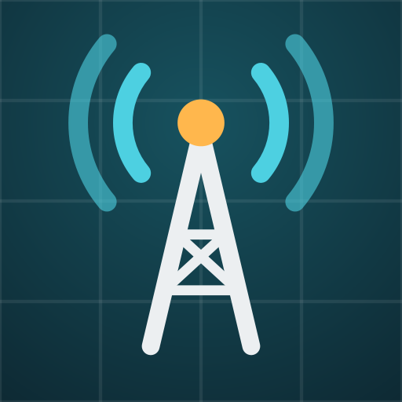

<p align="center">
  
</p>

<h1 align="center">TAKwave</h1>

<p align="center"><b>TAK over ordinary analog radios.</b><br>
Positions, chat and map markers between ATAK users with no cell service, no mesh hardware and no ATAK plugin.</p>

<p align="center">
  
  
  
  
</p>

---

TAKwave is an Android app that runs next to ATAK-CIV (or any TAK client) on the same phone. It
looks like a TAK server to ATAK, but instead of the internet it uses a VHF/UHF handheld: it
squeezes Cursor-on-Target messages into tiny binary packets and sends them as 1200-baud AFSK
audio, the same signalling APRS uses. The other phones decode the audio and their ATAK shows
your team on the map.

```
 ATAK ──TCP──► TAKwave ──► compact packet ──► AX.25 ──► AFSK audio ──► radio ))))
 ATAK ◄──TCP── TAKwave ◄── CoT XML rebuilt ◄── AX.25 ◄── AFSK audio ◄── radio ((((
```

> **Status: 0.1.0, first release.** The protocol, modem and gateway logic are covered by a unit
> test suite, and the app builds for debug and release. It has **not yet been tested on real
> phones and radios**; see [docs/TODO.md](docs/TODO.md). Treat it as a beta.

## Features

- **Works with stock ATAK-CIV.** No plugin, no plugin signing. Also works with iTAK, WinTAK or
  anything else that can connect to a TCP CoT server.
- **Carries what matters:** your position (PLI), GeoChat messages, and point markers.
- **Built for a slow channel.** A position report is about 37 bytes on the air. Reports are
  throttled, chat jumps the queue, stale traffic is dropped.
- **Software modem.** Bell 202 AFSK 1200 baud, written in Kotlin, with several parallel
  demodulators so it copes with real handheld audio.
- **Plays fair on a shared channel.** Carrier-sense channel access (p-persistent CSMA), plus
  optional GPS-timed transmit slots so stations take turns.
- **Radio safe.** Refuses to transmit without a callsign, never re-sends what it heard, and a
  watchdog force-releases PTT.
- **Hardware you may already own.** A Digirig (or any USB sound card with a serial PTT line), a
  VOX cable, an external KISS TNC, or nothing at all for a speaker-to-microphone test.
- **Optional payload encryption for Part 90 use**, with passphrase, key-file, and public-key
  options. Off by default; **not legal on amateur bands**.
- **100% free software.** No Google Play Services, no analytics, no network access beyond the
  local TAK socket. GPL-3.0-or-later.

## Who it is for

Licensed amateur radio operators, and Part 90 (business band) licensees. **You need a licence
to transmit**, and you are responsible for following the rules of the service you operate in:
identification, permitted content, band plan, and (on amateur bands) no encryption.

## What you need

| Item | Notes |
|------|-------|
| Android phone | Android 10 or newer, with USB host (OTG) support for a wired interface |
| TAK client | ATAK-CIV from the Play Store, on the same phone |
| Radio | Any FM handheld or mobile, VHF or UHF |
| Audio interface | [Digirig Mobile](https://digirig.net) recommended: USB sound card plus serial PTT in one |
| Cables | The Digirig cable for your radio model, and a USB-C OTG cable or adapter |

Alternatives: a simple audio cable with the radio's VOX; an external TNC or
[Dire Wolf](https://github.com/wb2osz/direwolf) reached over KISS TCP; or no hardware at all
for the acoustic test below.

## Install

Build from source (see [Building](#building)), or once published, install from F-Droid.

## Quick start

### 1. Set up TAKwave

1. Open TAKwave and go to **Settings**.
2. Enter your **callsign** and SSID. This is required: every packet carries it in the clear as
   your station identification, and TAKwave will not transmit without it.
3. Leave everything else at the defaults for a first test.
4. Go to **Status** and press **Start**. Allow microphone access (that is how the app hears the
   radio) and notifications. Accept the battery prompt so Android does not pause the app.

### 2. Connect ATAK

1. On the **Status** tab press **Export ATAK data package** and share the zip to ATAK
   (choose ATAK or its Import Manager in the share sheet).
2. ATAK adds a server connection named **TAKwave** pointing at `127.0.0.1:8087` over TCP.
3. The connection indicator in ATAK turns green, and "TAK clients" in TAKwave shows 1.

<details>
<summary>What is in the data package, and manual setup</summary>

The zip is a standard ATAK mission package:

```
MANIFEST/manifest.xml   MissionPackageManifest version 2, random uid, name "TAKwave"
takwave.pref            ATAK preference file
```

`takwave.pref` sets the `cot_streams` preference:

| Key | Value |
|-----|-------|
| `count` | `1` |
| `description0` | `TAKwave` |
| `enabled0` | `true` |
| `connectString0` | `127.0.0.1:<port>:tcp` |

To set it up by hand instead: ATAK > Settings > Network Preferences > TAK Servers > Add, with
address `127.0.0.1`, port `8087`, protocol **TCP** (not SSL), no credentials.

For a TAK client on another device (for example iTAK on this phone's hotspot), turn on **Allow
LAN clients** in TAKwave's settings and point that client at the phone's IP address. There is
no authentication, so only do this on a network you control.
</details>

### 3. First test: two phones, no radios (acoustic test mode)

With no audio interface attached TAKwave uses the phone's own speaker and microphone.

1. Set up two phones as above, each with its own callsign, PTT method **VOX**.
2. Put them on a table 20 to 50 cm apart, media volume at roughly 70%, in a quiet room.
3. Start both. Within a minute each phone chirps (that is a position report), and the other one
   lists it under **Heard** and shows it on the ATAK map.
4. Send a GeoChat message to *All Chat Rooms* from one ATAK. It should appear on the other.
5. The **Log** tab shows every packet sent and received.

If nothing decodes, check the **Calibrate** tab on the receiving phone: the level bar should go
green while the other phone transmits. Red means too loud; grey means too quiet.

### 4. On the air

**Radio settings**

- A **simplex** frequency set aside for data in your local band plan. Do not use the national
  APRS frequency (144.390 MHz in North America), voice calling frequencies, or repeater inputs.
- **Squelch:** open, or as loose as it goes. A tight squelch chops off the start of packets.
- **VOX off** on the radio when using serial PTT. Battery saver / power save **off**: it
  misses the start of packets.
- **Volume:** set once using the Calibrate tab, then leave it alone.
- Low power is plenty for testing. Use a dummy load where you can.

**TAKwave settings**

1. Plug in the Digirig. Android offers to open TAKwave for the USB device; accept and tick
   "always" so the permission sticks.
2. **Settings > Audio devices:** choose the USB audio device for both input and output.
3. **Settings > PTT:** choose *Serial (RTS/DTR)*, pick the adapter, and grant access. The
   Digirig keys on **RTS**, normal polarity.
4. Restart the gateway (button at the top of Settings).
5. **Calibrate tab:**
   - *Receive:* open the squelch and adjust the radio's volume until the level bar is green
     (peaks between about 20% and 80%).
   - *Transmit:* send the 1200 Hz and 2200 Hz tones while listening on a second radio. Adjust
     **TX audio level** until the tones are about as loud as a normal voice transmission, then
     back off a little. Overdriving is the most common cause of packets that will not decode.
   - Press **Send test PLI** and check that the other station lists you under Heard.

## How it behaves on the channel

| | |
|---|---|
| Channel rate | 1200 baud, roughly 100 to 150 bytes per second |
| Position reports | Every 60 s; sooner (but never under 15 s) after moving 50 m or turning 30° while moving |
| Priority | Chat, then markers, then positions |
| Stale traffic | Anything queued longer than 2 minutes is dropped |
| Channel access | Waits for a clear channel, then p-persistent CSMA (slot 100 ms, persistence 63) |
| TX timeout | 10 s per transmission, then PTT is forced off |

All of these are adjustable in Settings.

### Taking turns: time slots

With a handful of stations, carrier sensing alone works well. It fails when two stations
cannot hear each other but a third hears both (the "hidden node" problem): they transmit at
the same time and the third decodes neither.

Turn on **Settings > Time slots** to give every station its own turn. Time is divided into a
repeating cycle of slots (default 8 slots of 3 seconds), locked to UTC, so all phones agree on
the schedule without sending anything. A station only keys up inside its own slot, and only if
the packet will finish before the slot ends.

- Give every station the **same slot length and slot count**, and a **different slot number**.
- Leave the slot number at 0 to derive it from the callsign. That is convenient, but two
  callsigns can land on the same slot, so assign numbers by hand for a team.
- Phones need the right time to within about a quarter of a second. A phone that has had a
  network connection recently is fine. Off-grid for long periods, choose the **GNSS** time
  source; it uses satellite time whenever the GPS is running, which ATAK ensures.
- Carrier sensing stays active inside the slot, so a station with a wrong clock, or one not
  using slots, is waited for rather than transmitted over.
- One transmission per cycle per station: keep the PLI interval longer than the cycle.

## Encryption (Part 90 only)

> **Encryption is not permitted on amateur radio frequencies.** It is off by default. Turn it
> on only where your licence allows it. Your callsign is always sent in the clear.

| Mode | What every station loads | Use it when |
|------|--------------------------|-------------|
| Pre-shared passphrase | The same passphrase | Quick setup for a small group |
| Symmetric key file | The same 128/192/256-bit key file (raw, hex or Base64) | You distribute keys as files |
| Key pair with one peer (ECDH) | Own private key + the other station's public key | A two-station link |
| Team public key (ECIES) | Team public key; plus the team private key to read | Some devices should send but never be able to read |

Symmetric modes use AES-GCM or ChaCha20-Poly1305. Public-key modes accept **EC P-256** and
**X25519** keys in PEM (PKCS#8 private, X.509 public). RSA keys are refused, because an RSA
ciphertext is larger than a whole radio packet.

Creating keys with OpenSSL:

```sh
# Symmetric key file
openssl rand -out takwave.key 32

# EC P-256 key pair (works on every supported Android version)
openssl genpkey -algorithm EC -pkeyopt ec_paramgen_curve:P-256 -out team-private.pem
openssl pkey -in team-private.pem -pubout -out team-public.pem

# X25519 key pair (needs a recent Android version)
openssl genpkey -algorithm X25519 -out team-private.pem
openssl pkey -in team-private.pem -pubout -out team-public.pem
```

Import the files under **Settings > Encryption**. TAKwave shows a short key id for each public
or symmetric key; compare it between stations to confirm everyone loaded the same one. If the
keys are missing or wrong, TAKwave refuses to transmit rather than falling back to clear text.
Details are in [docs/PROTOCOL.md](docs/PROTOCOL.md).

## Troubleshooting

| Symptom | Things to check |
|---------|-----------------|
| ATAK does not connect | Is the gateway started? Is the server in ATAK set to **TCP**, `127.0.0.1`, port 8087? Re-import the data package. |
| "No valid callsign" warning | Set the callsign in Settings, then restart the gateway. |
| Nothing is transmitted | Callsign set? Serial PTT warning on the Status tab? Is the queue growing (channel busy)? With time slots on, sends wait for your slot. |
| Radio keys but the other side decodes nothing | TX level too high (most common), or too low. Raise TXDELAY to 400-500 ms. Turn off the radio's battery saver. |
| Level bar stays grey | Wrong input device, cable in the wrong jack, squelch closed, or volume too low. |
| Level bar red | Turn the radio volume down. |
| RF state stuck on RX-DCD | Voice or interference on the channel. TAKwave is waiting for it to clear. |
| Start of packets cut off | Squelch too tight, battery saver on, or TXDELAY too short for the radio (or for VOX). |
| USB adapter not listed | Use an OTG-capable cable or adapter; check the phone supports USB host. Press "Refresh device list". |
| Stops working with the screen off | Allow "background running" from the Status tab; some vendors need the app excluded in their own battery settings too. |
| Encrypted packets are dropped | Compare key ids and the encryption mode on both stations; the Log tab gives the reason. |
| Stations still collide with time slots on | Same slot length and count everywhere? Two stations on the same slot number? Phone clocks wrong (try the GNSS time source)? |

The **Log** tab records every packet with a decoded summary and hex dump. Use **Export** to
attach it to a bug report.

## Building

Requirements: JDK 17 or newer and the Android SDK (platform 37). No other setup.

```sh
./gradlew :core:test          # protocol, modem and gateway unit tests
./gradlew assembleDebug       # app/build/outputs/apk/debug/app-debug.apk
./gradlew assembleRelease     # unsigned unless keystore.properties exists
```

Every build runs `checkFossDependencies`, which fails if a Google Play Services, Firebase,
ML Kit, Play Billing or Play Core artifact appears anywhere in the dependency graph.

### Release signing

Release builds are signed when a `keystore.properties` file exists in the project root. Both
that file and the keystore are git-ignored; never commit them.

```properties
storeFile=TAKwave-Release.jks
storePassword=...
keyAlias=...
keyPassword=...
```

`storeFile` is relative to the project root, so keep `TAKwave-Release.jks` there (or give a
path elsewhere on your machine).

## Project layout

| Module | Contents |
|--------|----------|
| `:core` | Pure Kotlin/JVM, no Android: CoT parsing and building, binary codec, crypto, AX.25, HDLC, AFSK modem, KISS, scheduler, channel access, gateway logic. All unit tests live here. |
| `:app` | Android: foreground service, audio, PTT, USB, TCP server, Compose UI. |
| `:usbserial` | Vendored [usb-serial-for-android](https://github.com/mik3y/usb-serial-for-android) (MIT). |
| `:xmlparser` | kXML 2 (BSD) repackaged without the `org.xmlpull` API that Android already ships. |

Documentation:

- [docs/PROTOCOL.md](docs/PROTOCOL.md): the over-air format, byte by byte
- [docs/DECISIONS.md](docs/DECISIONS.md): design decisions and why
- [docs/TODO.md](docs/TODO.md): known gaps and what has not been verified
- [CHANGELOG.md](CHANGELOG.md)
- [AGENTS.md](AGENTS.md) and `.agent_manifest.json`: contributor rules and a code map

## Privacy

TAKwave has no accounts, analytics, ads, crash reporting or cloud services. It opens a TCP
socket on the phone for TAK clients (loopback only, unless you enable LAN clients) and, if you
choose the KISS backend, a connection to the TNC you configure. Nothing else leaves the device
except what you transmit by radio, which anyone on the frequency can receive.

## Acknowledgements

- [usb-serial-for-android](https://github.com/mik3y/usb-serial-for-android) by Mike Wakerly and
  contributors (MIT)
- [kXML 2](http://kxml.org) by Stefan Haustein (BSD)
- The clock-recovery approach in the demodulator follows the technique described in the
  [Dire Wolf](https://github.com/wb2osz/direwolf) documentation by WB2OSZ; the code is original.

TAKwave is not affiliated with or endorsed by the TAK Product Center. ATAK, iTAK and WinTAK are
products of their respective owners.

## License

Copyright (C) 2026 fearmikey

This program is free software: you can redistribute it and/or modify it under the terms of the
GNU General Public License as published by the Free Software Foundation, either version 3 of
the License, or (at your option) any later version. It is distributed WITHOUT ANY WARRANTY. See
[LICENSE](LICENSE).
